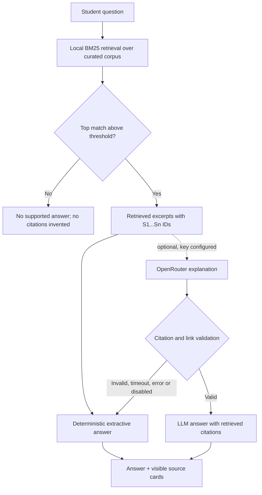

# Architecture

CareerGraph AI is a React single-page application backed by a FastAPI service. The core career
logic is deterministic Python; the optional language model can only explain retrieved evidence and
cannot change a readiness score or roadmap order.

The editable architecture asset is
[`docs/assets/architecture.svg`](assets/architecture.svg). It shows the default local path and the
optional external paths as distinct branches.

## System context

| Layer | Responsibility | Main code |
| --- | --- | --- |
| React frontend | Authenticated route guards, forms, loading/empty/error states, source cards, responsive navigation | `frontend/src/` |
| FastAPI API | HTTP validation, JWT authentication, role checks, response schemas, route ownership | `backend/app/routes/`, `backend/app/schemas/` |
| Application services | Resume extraction, readiness, graph traversal, roadmap planning, assessment grading, mentor ranking, advisor retrieval and validation | `backend/app/services/` |
| Relational database | Accounts, profiles, resume metadata/extracted text, roadmaps, assessments, mentorship requests and GitHub verification records | SQLAlchemy models and Alembic revisions |
| Skill graph | Curated prerequisite relationships; in-memory by default and an optional Neo4j adapter | `backend/app/data/skill_prerequisites.py`, `backend/app/services/graph_service.py` |
| Curated data | Skill taxonomy, occupation catalog, assessment bank and career-knowledge corpus | `backend/app/data/` |
| Optional LLM | A backend-only OpenRouter explanation after local retrieval succeeds | `backend/app/services/career_intelligence_service.py` |

## Component responsibilities

### Frontend

- Vite + React 19 with lazy-loaded route pages and a catch-all 404.
- The API layer in `frontend/src/services/api.js` attaches the JWT and normalizes FastAPI errors.
- Protected routes require a session. The backend enforces student, alumni and admin role
  boundaries; the SPA itself gates pages by authentication rather than rendering separate
  role-specific route trees.
- The advisor page exposes loading, empty, error and success states, retrieved source cards, and an
  explicit local-mode versus validated-LLM label.
- The design system lives in `frontend/src/index.css`; the app collapses primary navigation at
  1080px and hides the auth aside below 980px.

### API and authentication

- FastAPI routes are grouped by domain: auth, health, profiles, resumes, career, graph, roadmap,
  assessments, mentorship, verification and intelligence.
- Passwords are hashed with bcrypt. Login returns a JWT signed with `SECRET_KEY`; the frontend
  stores the token in local storage and sends it as `Authorization: Bearer <token>`.
- Missing, malformed or expired tokens return `401`, not `500`.
- Role checks and ownership checks are applied in the route/service layer. Resource endpoints that
  should not reveal another user's records return `404` rather than confirming their existence.
- The API documentation is available at `/docs` while the backend is running.

### Deterministic application services

| Service | What is deterministic | Output |
| --- | --- | --- |
| Resume extraction | Regex/taxonomy matching over extracted text, confidence and evidence snippets | Suggested skills that the student must review and confirm |
| Readiness | Weighted coverage of curated required skills | Percentage, band, per-skill contributions and an explanation |
| Skill graph | Bounded prerequisite traversal, cycle checks and topological ordering | Prerequisite/dependent relationships and roadmap order |
| Roadmap | Required skills + graph prerequisites, excluding skills already held | Ordered steps with persisted progress |
| Assessments | Exact answer matching, per-skill pass threshold | Score, per-question review and suggested evidence |
| Mentor matching | Itemized weighted heuristic over observable profile facts | Ranked mentors, factor breakdown and disclaimer |
| GitHub evidence | Deterministic repository-language/topic analysis | Suggested skills with repository evidence |
| Advisor retrieval | Local BM25 lexical ranking and thresholding | Retrieved source chunks and a source-attributed answer |

None of these services calls an LLM to calculate a score, grade an assessment, order a roadmap or
rank a mentor.

### Relational database

- **SQLite** is the default local development database
  (`sqlite:///./careergraph_dev.db`, relative to the backend working directory).
- **PostgreSQL 16** is the shared-deployment path and is exercised by the CI integration job with a
  disposable service container.
- Alembic is the authoritative schema history. Startup creates tables in development, but shared
  environments should apply `alembic upgrade head` and run `alembic check` before serving.
- Resume files and extracted text are stored by the backend; the `backend/uploads/` directory is
  ignored by Git. Production file storage should be backed up and access-controlled separately.

### Skill graph and Neo4j

`InMemorySkillGraph` is the default and is built from curated prerequisite edges. It implements the
same traversal and ordering algorithms used by the roadmap service. `Neo4jSkillGraph` persists the
curated edges in Neo4j and reuses the algorithms. If `GRAPH_BACKEND=neo4j` but the server is
unreachable or the driver cannot connect, the application logs a warning and falls back to the
in-memory graph. The live Neo4j checks are opt-in and are configured in CI with a disposable
container.

### Grounded Career Advisor

Retrieval is local lexical BM25 over the curated in-repo corpus: 94 documents split into 102
retrievable chunks, with `k1=1.5`, `b=0.75`, default top-k 6; the top lexical match must meet
the minimum score threshold. The question alone is the retrieval query. The student's target role,
readiness context and roadmap step names are supplied separately so an off-topic question is not
made relevant by the saved profile.



**Prompt boundary.** When an OpenRouter key is configured, only the question, target occupation,
canonical skill names, deterministic gap summary, roadmap step names and retrieved excerpts are
sent. Stored resume files/text, profile names/emails, account IDs and tokens are not included. The
typed question is included, so it must not contain secrets or third-party personal data. The key is
read by the backend only and is never returned by `/intelligence/status`.

**Validation.** An LLM answer is accepted only when it contains at least one valid `[S#]` citation,
cites only IDs from the retrieved set, contains no external URL, and is between 20 and 3000
characters. Otherwise the service returns the deterministic extractive answer, sets
`mode="grounded_extractive"` and records a fallback notice. `llm_used` is exactly
`mode == "llm"`.

**Sources, not course links.** Source cards contain internal titles, labels, kinds, scores and
excerpts from the curated corpus. The advisor does not generate external course URLs.

### Failure handling

| Condition | Behavior |
| --- | --- |
| SQLite/PostgreSQL unavailable | Health check reports the failure; data operations fail with an API error rather than fabricated data |
| `GRAPH_BACKEND=neo4j` unreachable or driver missing | Log warning and use the in-memory graph |
| Ask question unsupported by corpus | Return an explicit no-supported-answer response with no citations |
| OpenRouter key absent | Return a deterministic extractive answer; `llm_used=false` |
| OpenRouter timeout/error/invalid answer | Fall back to the deterministic answer and report the truthful mode/notice |
| GitHub account not found | `404` |
| GitHub rate limit or network failure | `503` with an explicit message |
| Other GitHub upstream error | `502` |
| Unknown occupation requested | `404`; a stale saved role is treated as no target role for general questions |
| Non-owner roadmap/mentorship request | `404`, so the endpoint does not confirm another user's record exists |

## Request and data flow

### Authentication and profile

1. The browser submits credentials to `/auth/login`.
2. The backend verifies the bcrypt hash and returns a JWT.
3. The frontend attaches the token to API calls.
4. Profile update routes load the current user and apply role-aware update logic.

### Resume review and provenance

1. The student uploads a PDF, DOCX or TXT file.
2. The backend extracts text locally and matches it against the curated taxonomy.
3. The review response includes extracted matches, confidence, evidence and existing profile skills
   that are not already backed by assessment or GitHub evidence.
4. Confirming accepts only `resume` or `self` provenance. Assessment and GitHub evidence is
   preserved; a resume review cannot downgrade verified evidence.

### Readiness and roadmap

```text
profile skills
    -> normalize through taxonomy
    -> weighted coverage of occupation.required_skills
    -> readiness score + contributions

occupation.required_skills
    -> remove skills already held
    -> add missing graph prerequisites
    -> deterministic topological order
    -> roadmap snapshot + separate progress rows
```

The readiness score is a deterministic coverage metric, not a probability of employment. Only
required skills affect the score; optional skills are informational. Unknown skills neither help
nor hurt.

### Evidence and mentorship

- Assessments grade exact answers and only suggest skills that were passed; the student confirms
  what to add.
- GitHub verification reads public repository metadata from the unauthenticated GitHub REST API,
  excludes forks, and only suggests detected skills; confirmation is explicit.
- Mentor matching ranks by gap overlap, shared college, experience, availability and free capacity.
  The API returns the factor breakdown and does not present the score as a probability.
- Mentorship requests are party-scoped and capacity-enforced on acceptance.

### Advisor request flow

1. The authenticated student submits a question and optional occupation key.
2. The service loads the saved target role and deterministic context.
3. BM25 ranks up to `RAG_TOP_K` curated chunks; the top match must reach `RAG_MIN_SCORE`.
4. If the top match is below the threshold, the response explicitly refuses to answer from
   unsupported sources.
5. The deterministic extractive answer is always constructed.
6. If an LLM is configured, the minimal prompt is sent and the response is validated.
7. The API returns the answer, mode, sources, deterministic context, privacy note and limitations.

## Design decisions

- **Deterministic scores:** reproducible and testable; an LLM cannot invent or alter them.
- **Lexical retrieval:** the corpus is small and curated; BM25 needs no model download or vector
  database. The trade-off is that paraphrases outside the query-expansion map may be rejected.
- **Optional LLM:** the product remains useful and auditable without a paid key.
- **In-memory graph by default:** zero infrastructure for local work, with the same algorithms and
  a tested Neo4j path for shared deployments.
- **Explicit evidence confirmation:** the student owns the profile; automated extraction suggests,
  it does not silently rewrite evidence.
- **Honest labels:** LinkedIn is unverified, assessments are not certifications, readiness is not a
  hiring probability, and a fallback answer is visibly labelled as local mode.

## Related documentation

- [API reference](API.md)
- [Development setup](DEVELOPMENT.md)
- [Testing](TESTING.md)
- [Security](SECURITY.md)
- [Deployment](DEPLOYMENT.md)
